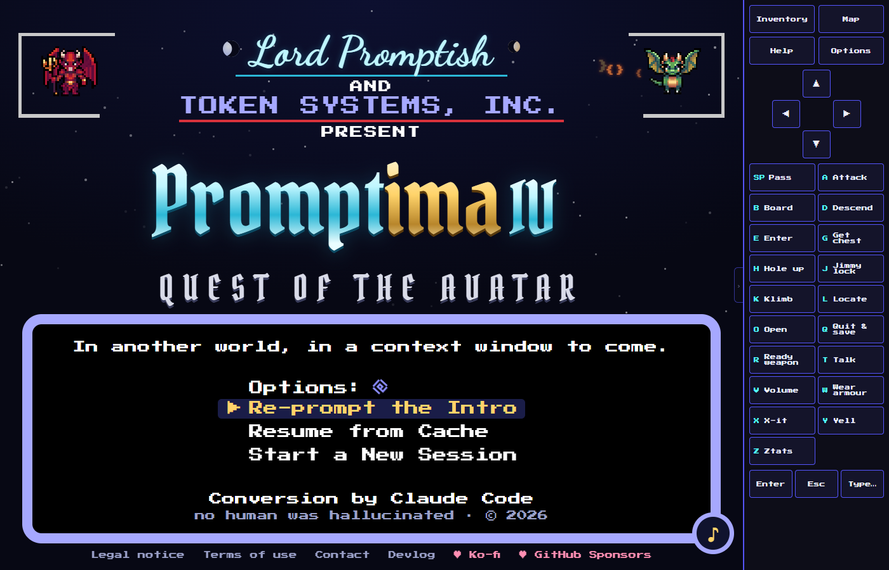
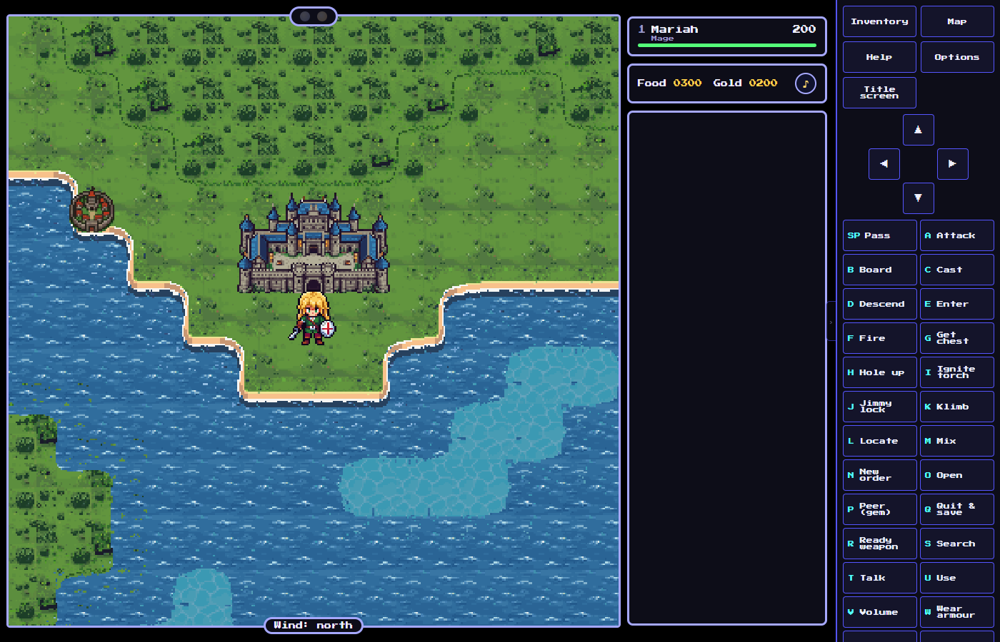
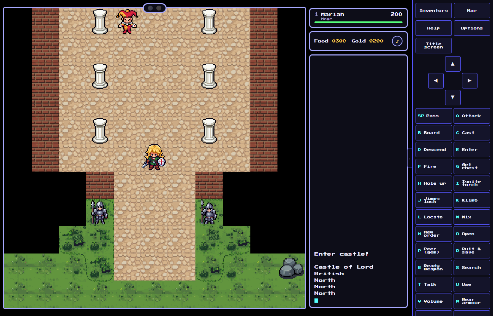
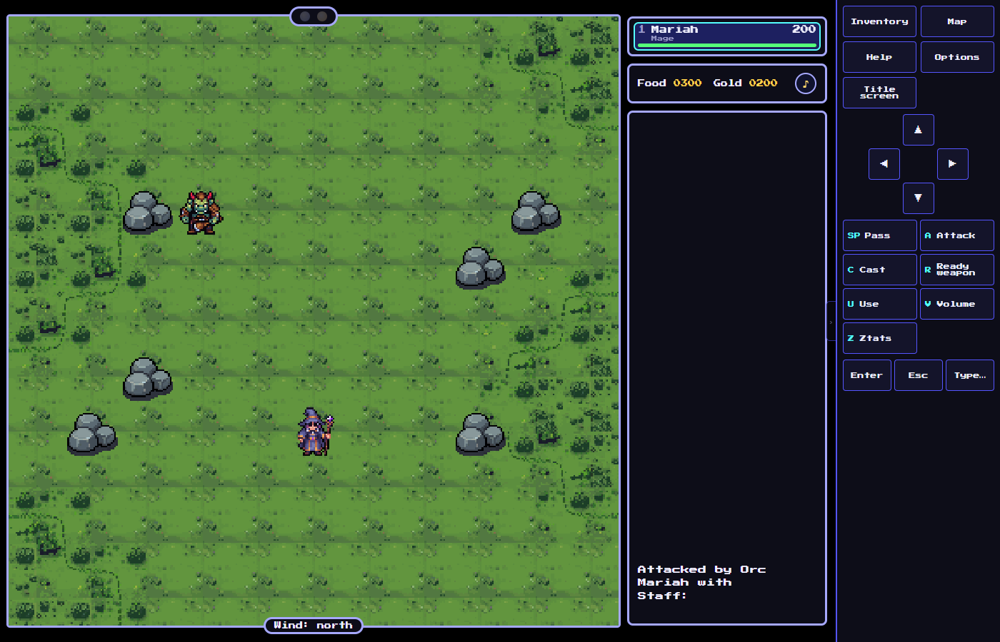
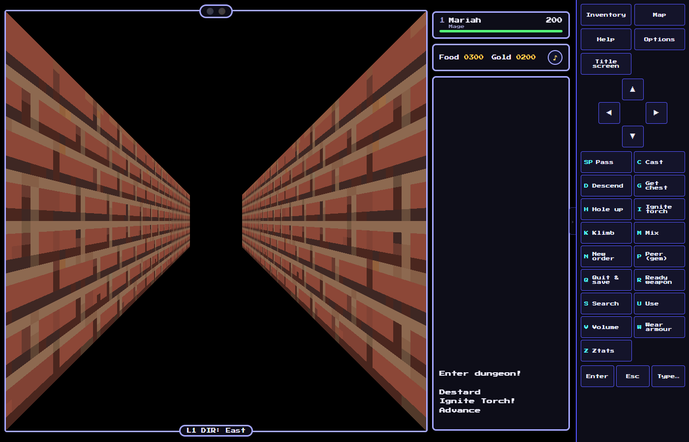
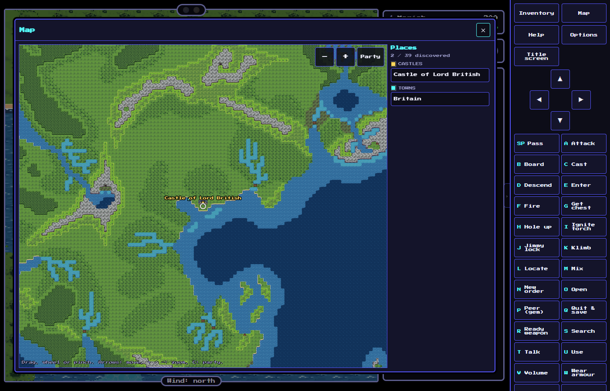
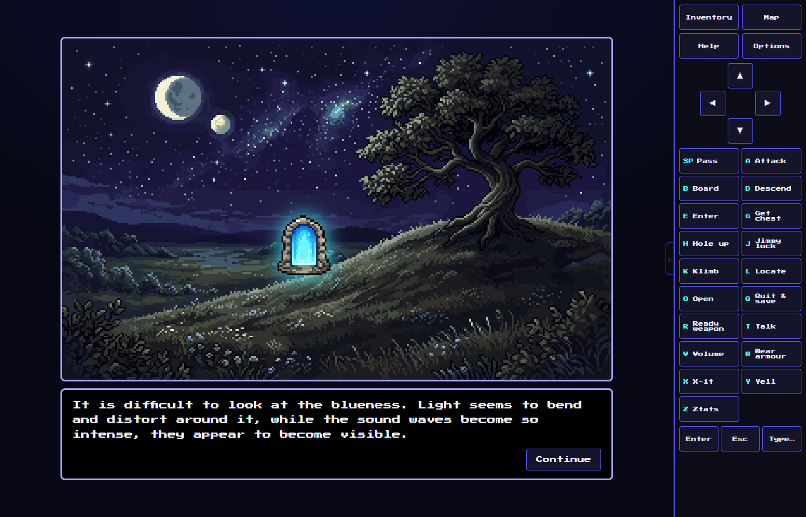
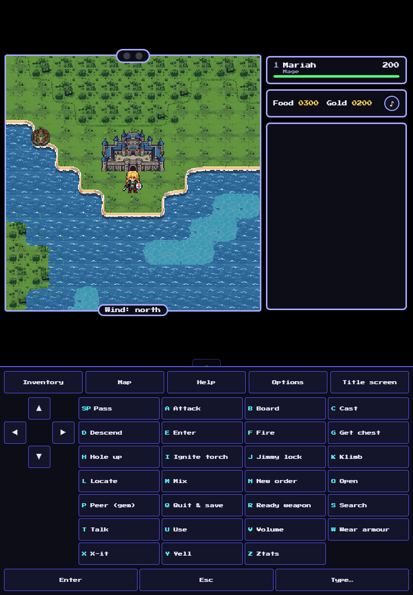

# Promptima IV — Ultima IV en TypeScript + three.js + Tauri

*[English version](README.md)*

**Jouer dans le navigateur : [promptima.app](https://promptima.app)** · [Devlog](https://promptima.app/devlog/)

<p align="center"></p>

Réimplémentation d'**Ultima IV: Quest of the Avatar** (version DOS vendue par GOG) en TypeScript,
avec un rendu three.js et une application de bureau Tauri v2.

Le moteur a été reconstruit par rétro-ingénierie du jeu original : décodage des formats de fichiers
et décompilation avec Ghidra des exécutables (`AVATAR.EXE`, après suppression de sa compression
EXEPACK, et `TITLE.EXE`). Les règles, formules et tables citent en commentaire les adresses des
fonctions originales (`1000:xxxx`) et des données (`DS:xxxx`). Voir `docs/RE_NOTES.md`.

## Captures

<table>
<tr><td width="50%"><br><sub>Le monde</sub></td><td width="50%"><br><sub>Le château de Lord British</sub></td></tr>
<tr><td width="50%"><br><sub>Un combat</sub></td><td width="50%"><br><sub>Un donjon en 3D</sub></td></tr>
<tr><td width="50%"><br><sub>La carte du monde (F3)</sub></td><td width="50%"><br><sub>La création du personnage</sub></td></tr>
</table>

<p align="center"><br><sub>L'écran adaptatif sur tablette (portrait), avec la barre de commandes tactile</sub></p>

Toutes les captures montrent l'édition 2026 telle que fournie dans ce dépôt (aucun graphisme original).

## Données du jeu et graphismes originaux

Aucun code original n'est exécuté (pas de DOSBox, pas d'émulation), et le moteur ne lit pas non plus
les fichiers originaux : leur contenu a été **extrait** dans des formats modernes par un outil
TypeScript, et le jeu ne lit que `assets/`.

**Fourni avec le dépôt** : les cartes, dialogues, tables et catalogues de textes extraits du jeu
(`assets/original/`, en JSON), leurs traductions françaises (`assets/i18n/`), et les graphismes, sons et
musiques propres à l'édition 2026 (pack de tuiles et illustrations PixelLab, effets ElevenLabs, morceaux
Suno). Un clone frais se joue tel quel, avec le style de l'édition.

**Non fourni** : les graphismes originaux (tuiles EGA, police 8x8, images plein écran) et les packs de
tuiles qui en dérivent. Si vous possédez Ultima IV (gratuit sur GOG), extrayez-les une fois pour jouer
avec le style de 1987 (*Options* : pack `original` ou `scale4x-derived`, police originale, écran et
titre de 1987) :

```powershell
npm run extract -- --game-dir "C:\Program Files\GOG Galaxy\Games\Ultima 4"
```

L'outil (`tools/extract-assets.ts`) décompresse `AVATAR.EXE` (EXEPACK) en mémoire, lit ses textes et
ceux de `TITLE.EXE` aux offsets déclarés dans le code et réécrit `assets/original/` (les fichiers JSON
versionnés ressortent inchangés de la version GOG). Il y ajoute les graphismes originaux et construit
les packs Scale4x et Scale3x (`assets/packs/*-derived/`, `--no-packs` les saute) ; tout cela est ignoré
par git. Sans `--game-dir`, il utilise `U4_GAME_DIR` ou l'emplacement GOG Galaxy ci-dessus.
L'installation originale n'est jamais modifiée : les sauvegardes vont dans le dossier de données de
l'application (Tauri) ou dans le `localStorage` (mode navigateur).

Un build laisse les graphismes originaux hors de `dist/` même s'ils ont été extraits : un site déployé
ne les sert donc jamais. Pour un build personnel qui les inclut (votre propre application de bureau),
définissez `U4_BUNDLE_ORIGINALS=1` avant `npm run build` / `npm run tauri build`, et ne le distribuez
pas.

Le code source déclare seulement *où* se trouve chaque texte original (par exemple
`talk.youSay: 0x2a62`, un offset DS dans `AVATAR.EXE`) ; les textes viennent du catalogue extrait.

## Lancer

Node.js est fourni dans `.nodeenv` ; Rust (chaîne MSVC) est nécessaire pour Tauri.

PowerShell :

```powershell
$env:Path = "$PWD\.nodeenv\Scripts;" + $env:Path
npm install
npm run tauri dev   # application de bureau, rechargement à chaud du front
npm run dev         # navigateur seul : http://127.0.0.1:1420
npm run build       # vérification des types + bundle de production
npm test            # tests unitaires (Vitest) ; ceux des formats sont ignorés sans installation
node tools/scenarios.mjs [--ref]  # non-régression par captures headless (serveur de dev lancé)
npx tsx tools/packs/upscale.ts --algo scale2x  # un pack de plus dérivé des tuiles extraites (assets/packs/scale2x-derived)
```

Git Bash : `export PATH="$PWD/.nodeenv/Scripts:$PATH"`, puis les mêmes commandes.

En mode dev, `http://127.0.0.1:1420/?skipintro` démarre directement sur la carte du monde (utilisé
par les tests automatisés) ; l'instance du jeu est exposée dans `window.__game`.

## Organisation

| Dossier | Contenu |
|---|---|
| `tools/extract-assets.ts` | extraction unique des fichiers originaux vers `assets/original/` (décompresseur EXEPACK dans `tools/exe`) |
| `src/formats` | décodeurs des formats originaux, utilisés par l'extracteur et les tests |
| `src/assets` | accès aux ressources extraites (`AssetStore`) : tuiles, police, images, cartes, dialogues, textes, packs de tuiles |
| `src/data` | tables de règles citées par adresse (`tables.ts`) et registre des textes (`text.ts` : textes déclarés par leur emplacement dans les exécutables) |
| `src/game` | moteur : état et boucle (`game.ts`), registre des commandes (`commands.ts`), commandes du groupe (`actions.ts`), lieux et villes (`places.ts`), transports, monde (`world/`), conversations (`talk.ts`, fournisseurs `conversation/`), boutiques, combat, donjons, sorts, objets, sanctuaires, fin du jeu, saisies, karma ; messages du moteur dans `texts/` |
| `src/render` | rendu three.js : packs de tuiles (toute taille), grille 11x11, couche UI 320x200 (police originale ou moderne), vue 3D |
| `src/ui` | calques de l'écran (`layers.ts`), panneau de statut, interface HTML (`dom/` : barre de commandes, panneaux, souris/tactile) et panneaux (`panels/` : inventaire, carte du monde, aide, options, débogage) |
| `src/i18n` | langues : catalogues de l'interface et textes écrits pour ce portage, par langue |
| `src/intro` | écran titre et création du personnage (cartes de la gitane) |
| `src/dungeon` | vue des donjons à la première personne (three.js) et tables des donjons |
| `src/config` | configuration (`config.json`) et valeurs par défaut |
| `tests`, `tools/scenarios.mjs` | tests unitaires (Vitest) et scénarios de non-régression par captures |
| `tools/packs` | outils de packs de tuiles : `upscale.ts` produit des packs HD à partir des tuiles originales par agrandissement pixel-art (Scale2x/3x/4x) |
| `src-tauri` | coquille Tauri v2 : sauvegardes et configuration dans le dossier de données de l'application |
| `docs` | notes de rétro-ingénierie, guide de traduction |

## Commandes (clavier, comme l'original)

Flèches : déplacement · A)ttack · B)oard · C)ast · D)escend · E)nter · F)ire · G)et chest · H)ole up ·
I)gnite torch · J)immy · K)limb · L)ocate · M)ix · N)ew order · O)pen · P)eer · Q)uit & save ·
R)eady · S)earch · T)alk · U)se · W)ear · X)it · Y)ell · Z)tats · Espace : passer

Dans les donjons : Haut/Bas pour avancer/reculer, Gauche/Droite pour tourner.

Interface : F1 aide · F2 inventaire · F3 carte du monde · F10 options · F12 débogage (avec `?debug` ou l’option).
Langue, police, pack de tuiles et contrôles se règlent dans les options (enregistrées dans `config.json`). En dev,
`?lang=fr`, `?pack=<nom>` et `?debug` les remplacent pour la session.

## iPad / tactile

Le jeu se joue aussi à la souris ou au doigt ; chaque toucher devient les touches de l'original.

- Monde et villes : toucher une case pour y marcher (pas à pas ; une touche, une question du jeu ou
  un combat arrêtent la marche). Toucher un voisin (habitant, monstre) pour Parler / Attaquer /
  Regarder, une porte pour Ouvrir / Crocheter, le groupe pour ce qu'il y a dessous (coffre, échelles,
  Entrer, Embarquer, Débarquer).
- Donjons : glisser vers le haut/bas pour avancer/reculer, gauche/droite pour tourner ; toucher pour
  les commandes du donjon.
- Combat : toucher un ennemi à côté du personnage actif pour l'attaquer, une autre case pour s'en
  approcher d'un pas.
- La barre de commandes donne les autres commandes et un champ de texte pour les conversations. La
  marche au toucher se désactive dans les réglages (`controls.tapToMove`).

Sur iPad, construire le jeu (`npm run build`, avec les fichiers extraits) et servir `dist/` depuis
une machine du même réseau (`npx vite preview --host`) ; le service worker et l'installation
demandent HTTPS (ou localhost). Dans Safari : Partager > Sur l'écran d'accueil. Le jeu démarre alors
en plein écran et garde ses fichiers en cache après la première visite.

## État

Implémenté : intro et création du personnage, monde extérieur (lunes, portes lunaires, vent,
navires, chevaux, monstres errants), villes (PNJ, ligne de vue, portes, conversations, toutes les
boutiques, auberges, guérisseurs, Lord British, Hawkwind, compagnons), combat tactique, donjons 3D
(salles, autels, pierres), sorts et mélanges, objets, sanctuaires et méditation, fin du jeu
(Abysse, Codex).

Certains détails sont des interprétations plutôt que des portages exacts (temporisations qui
dépendaient de la vitesse du CPU dans l'original, rendu 3D des donjons) ; ils sont signalés dans le
code.

Ajouté dans ce portage : anglais et français (les textes du jeu original sont traduits à partir
des fichiers extraits, voir `docs/TRANSLATING.md`), packs de tuiles interchangeables (des packs HD peuvent être
générés avec `tools/packs`), interface HTML (barre de commandes, inventaire, carte du monde, aide, options,
débogage), jeu à la souris et au doigt (déplacement par appui, menus contextuels, glissements) et application
web installable. La couche de conversation est prête pour un fournisseur LLM (`src/game/conversation`), non activé.

Hole up et la sauvegarde dans les donjons (DNGMAP.SAV) sont faits, et les sorts et objets jamais joués (Blink, Gate,
Winds, Dispell, Energy, Open, canons, New Order, télescope, autels, Abysse, Codex) ont été testés en jeu et comparés
aux routines d’origine ; le panneau de débogage (F12) prépare chacun d’eux.

## Licence

Le code source est sous [licence MIT](LICENSE). Le contenu extrait d'Ultima IV (cartes, dialogues,
textes) et ses traductions appartiennent à leurs ayants droit ; les illustrations, sons et musiques de
l'édition sont © 2026 Benjamin Marchand (voir `LICENSE`). Ultima est une marque d'Electronic Arts ; ce projet
n'est ni affilié ni approuvé par elle. L'historique antérieur du projet est archivé dans
[ultima4-ts](https://github.com/cyberbobjr/ultima4-ts).
